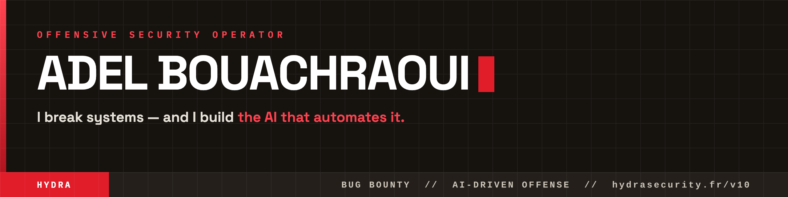

<!-- Profile README for github.com/Popy21 — repo must be named exactly "Popy21" -->

  
  
  

  
  
  

---

### `whoami`

Offensive security researcher & full-stack engineer. I **break web, infrastructure and AI systems** — and I **build the tooling that scales it**. Bug-bounty hunter on **YesWeHack** and **Apple**, with **two CVEs credited by name** — [WebKit](https://support.apple.com/en-us/127121) and [GNOME libsoup](https://www.cve.org/CVERecord?id=CVE-2026-12478). Every finding backed by a working PoC, never theoretical. Finishing a Cybersecurity Master's (work-study) in the south of France.

> Method: source-driven auditing and invariant reasoning over blind fuzzing — *"look where people don't look."*

|  | |
|---|---|
| **CVEs credited** | 2 — Apple WebKit · GNOME libsoup (Red Hat CNA) |
| **YesWeHack** | 7 rewarded · alias [`BaguettePwnM`](https://yeswehack.com/hunters/BaguettePwnM), KYC-verified |
| **Sectors** | health · public sector · fintech · e-voting · automotive · open source |

<!-- Optionnel, à décommenter une fois la référence publique confirmée :
| **MITRE CWE** | Content Development Repository submission accepted (CDR #207) |
-->

---

###  Vulnerability research

**Public CVEs** — credited by name in the vendor advisory.

| CVE | Component | What it was | Severity |
|---|---|---|---|
| **[CVE-2026-12478](https://www.cve.org/CVERecord?id=CVE-2026-12478)** | GNOME libsoup — WebSocket frame processing | The fix for CVE-2026-0716 put the integer-overflow guard *inside* the `if (masked)` block, so unmasked server→client frames stayed unguarded → out-of-bounds read in any client running `max_incoming_payload_size = 0`. Fixed in [MR !518](https://gitlab.gnome.org/GNOME/libsoup/-/merge_requests/518) | 4.8 · CWE-125 |
| **[CVE-2026-28962](https://support.apple.com/en-us/127121)** | Apple WebKit | Processing maliciously crafted web content may disclose sensitive user information. Fixed in Safari 26.5 | — |

**Selected findings** — reported privately through bug bounty programs. Targets are not named.

| Finding | Sector | Severity |
|---|---|---|
| **eIDAS Level-of-Assurance downgrade** — LOW silently mapped to SUBSTANTIAL, bypassing ACR requirements on a national identity federation | Digital identity | **8.6 High** |
| **OAuth `redirect_uri` over HTTP** — authorization codes transmitted in cleartext | Public finance | 6.8 |
| **POST-based XSS** on a password-reset flow, via an error parameter reflected unescaped | Public finance | 6.1 |
| **Unauthenticated search servlet** exposed on two production services | Public sector | 5.3 |
| **Improper access control** — an internal `/env` endpoint reachable through a forged auth header | Logistics | 5.3 |
| **WAF design bypass** on a public GraphQL endpoint | Banking | 3.7 |

Recurring classes: `OAuth / OIDC / eIDAS logic flaws` · `Broken access control & IDOR` · `DOM & POST XSS` · `Open redirect` · `SSRF` · `HTTP request smuggling` · `Hardcoded credentials in mobile apps` · `Memory safety in C` · `CI/CD supply chain`

>  **Responsible disclosure.** Live-target findings are reported privately through the relevant program and are **not** published here. What you'll find in my public repos is **CTF write-ups, lab PoCs against intentionally-vulnerable targets, my own tooling, and findings that have been publicly disclosed**. No undisclosed exploit code, ever.

---

###  HYDRA — autonomous AI offensive-security engine &nbsp;·&nbsp; [hydrasecurity.fr/v10/](https://hydrasecurity.fr/v10/)

My flagship: a system that runs the offensive loop on its own and **only reports what it can prove**.

- **Multi-model agent arena** — chains recon → exploitation → validation against a live target.
- **Exploit-proof gate** — a finding is promoted to High/Critical only when a *real exploit oracle* fires **and** several agents reach consensus. No reflection-only "RCE", no false positives.
- **Out-of-band collector** — proves blind RCE / SSRF end-to-end.
- **Cross-engagement memory** — primes new hunts and de-duplicates against prior work.

`Python` · `multi-LLM orchestration` · `Kali tooling` · `Docker` · `Traefik`

---

###  Public work

| Repo | What it is |
|---|---|
| **[security-research](https://github.com/Popy21/security-research)** | Vulnerability write-ups — every entry maps to a fixed, publicly tracked issue. Starts with the full [CVE-2026-12478](https://github.com/Popy21/security-research/blob/main/libsoup-CVE-2026-12478.md) analysis. |
| **[ai-infra-nuclei](https://github.com/Popy21/ai-infra-nuclei)** | Nuclei templates for **exposed AI/LLM infrastructure** — Ollama, vLLM, ComfyUI, LangServe, Ray, MLflow, ChromaDB, Qdrant. None of them ship an auth screen; the official template set is CVE-centric and barely covers the misconfiguration. |
| **[ctf-writeups](https://github.com/Popy21/ctf-writeups)** | Web security write-ups — PortSwigger / Juice Shop / picoCTF. |
| **[hydra](https://github.com/Popy21/hydra)** | Public overview of the HYDRA engine. |
| **[claude-news-mcp](https://github.com/Popy21/claude-news-mcp)** | Hosted MCP server exposing real-time Claude/Anthropic news to any MCP client. Free, no key. |

Detection templates also merged upstream into [`projectdiscovery/nuclei-templates`](https://github.com/projectdiscovery/nuclei-templates).

---

###  Also building — [claudenews.online](https://claudenews.online)

An independent AI-intelligence publication: **16 thematic dossiers** (sovereign AI, AI agents, AI & cybersecurity, regulation, open-source models…). I live in the AI world I attack.

---

###  Arsenal

**Offense** · web exploitation (XSS / CSRF / SQLi / IDOR / access control / open redirect), auth & federation protocols (OAuth 2.0, OIDC, SAML, eIDAS), source-driven auditing in C / Go / Python / JS-TS, Android static analysis, PoC development, recon 
**Systems** · Kali · BlackArch · Windows AD & Server · Docker · Nginx/Apache · TCP/IP · VPN · firewalls 
**Code** · Python · C# · Java · Swift · JS/TS (React, Next, Vue, Angular, Node) · PHP/Laravel 
**Governance** · ISO 27001 · GDPR (ANSSI) · IGI 1300

---

  <a href="https://hydrasecurity.fr/v10/"><b>hydrasecurity.fr/v10/</b></a> &nbsp;·&nbsp;
  <a href="https://www.linkedin.com/in/adel-bouachraoui-8407a4234/">LinkedIn</a> &nbsp;·&nbsp;
  <a href="mailto:adelb13000@gmail.com">adelb13000@gmail.com</a>
   HÉRA — independent security &amp; AI R&amp;D · references &amp; PoCs on request

